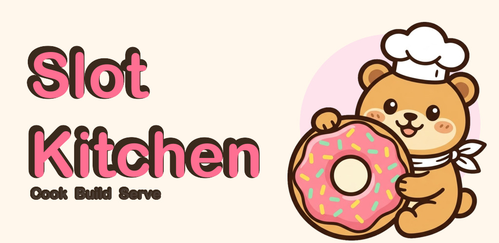

# 슬롯 키친

카드 기반 실시간 요리 타이쿤

[Google Play 스토어](https://play.google.com/store/apps/details?id=com.yelly.slotkitchen)

좁은 슬롯 판 위에서 줄 선 손님의 주문을 받고, 창고에서 재료를 꺼내, 도구로 조리해 서빙하는 게임이다. 주문서와 재료와 완성품이 한정된 슬롯을 나눠 쓰기 때문에 주문을 더 받아 대비할지 그 칸을 재료로 쓸지 계속 저울질해야 하고, 인내심이 다한 손님은 떠난다. 밀려오는 손님을 빠르게 쳐내 자리를 확보하는 정체 관리가 핵심 재미다.

한 판은 12주로, 매주 목표 점수를 넘겨야 다음 주로 갈 수 있다. 주를 통과해 번 돈으로 슬롯을 늘리고 버프 카드를 모으며 가게를 키우고, 달이 지날수록 거세지는 손님 물결을 끝까지 버티면 승리한다.
